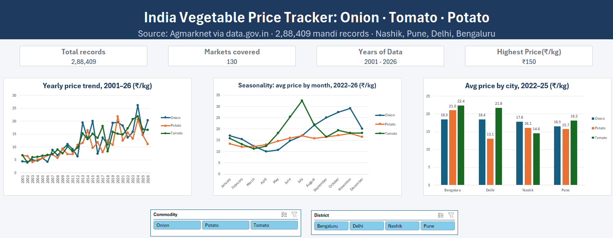
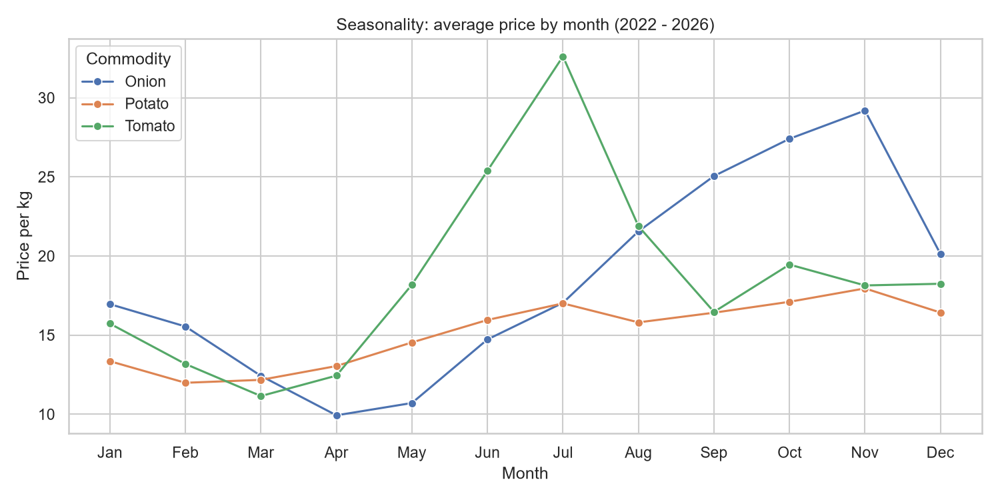

# India Vegetable Price Analysis

**End-to-end analysis of 25 years of government mandi (wholesale market) prices for onion, tomato and potato across 4 major Indian markets.**

`Excel` · `Power Query` · `MySQL` · `Python (pandas, seaborn)` · `Power BI` *(in progress)*



---

## 📌 Business Problem

Onion, tomato and potato are used in almost every Indian kitchen, and their prices regularly **spike suddenly** (the 2019 onion crisis and 2023 tomato crisis made national headlines). Price-monitoring teams usually react **after** prices have already peaked.

**Goal:** understand how these prices behave so decision-makers can **predict spikes and act early**: release buffer stock, plan transport, and warn consumers.

### Business questions

| # | Question |
|---|---|
| 1 | How have prices changed over 25 years? |
| 2 | In which months/seasons do prices spike for each vegetable? |
| 3 | Which vegetable is the most volatile? |
| 4 | Which city pays the most for the same vegetable? |
| 5 | Do producer markets (Nashik, Pune) sell cheaper than consumer cities (Delhi, Bengaluru)? |
| 6 | How wide is the gap between min and max price in the same mandi on the same day? |

---

## 📂 Data

| Item | Detail |
|---|---|
| **Source** | Agmarknet, Ministry of Agriculture & Farmers Welfare, via [data.gov.in](https://www.data.gov.in/resource/variety-wise-daily-market-prices-data-commodity) |
| **Collection method** | data.gov.in **REST API** (resource `35985678-0d79-46b4-9ed6-6f13308a1d24`), filtered by State, District and Commodity |
| **Commodities** | Onion, Tomato, Potato |
| **Markets** | Nashik & Pune (Maharashtra), Delhi, Bengaluru (Karnataka) |
| **Period** | 2001 – 2026 (daily) |
| **Raw files** | 13 CSV files (Nashik onion split into 2 parts due to the API's 50,000-row limit) |
| **Raw rows** | 2,88,473 |
| **Clean rows** | **2,88,409** |

**Columns:** State, District, Market, Commodity, Variety, Grade, Arrival_Date, Min_Price, Max_Price, Modal_Price (₹ per quintal; 1 quintal = 100 kg)

---

## 🛠️ Stage 1: Excel

### 1. Data cleaning (Power Query)
- Combined all 13 CSV files from a folder into one table (refreshable)
- Removed auto-detected data types and set them manually:
  - Dates parsed with **English (India)** locale (DD/MM/YYYY) to avoid day/month swaps
  - Prices set to Decimal Number (files had mixed integer/decimal types)
- **Trim** and **Clean** on all text columns (e.g. `"APMC Chandwad "` with trailing spaces)
- Standardised city names (`Bangalore` → `Bengaluru`)
- Removed duplicates (none found; row count verified against source files)

### 2. Data quality checks
Built a `Quality_Flag` rule and removed **64 bad records (0.02%)**:

| Issue | Rows | Example |
|---|---|---|
| Logic error (Modal price outside Min–Max range) | 9 | Min > Max |
| Extreme outlier | 12 | Onion at ₹91,75,88,483/quintal (typing error) |
| Too low (< ₹50/quintal) | 43 | Prices likely entered per kg instead of per quintal |

**Real price spikes were kept**, not deleted: the **Dec 2019 onion crisis** (₹120–140/kg) and the **Jul–Aug 2023 tomato crisis** (₹110–150/kg) appear across many markets at the same time, which confirms they are genuine events.

### 3. Feature engineering
Added: `Year`, `Month`, `Month_Name`, `Price_per_kg` (Modal ÷ 100), `Price_Spread` (Max − Min), `Market_Type` (Producer/Consumer), `Region` and `Season` (via **XLOOKUP** from lookup tables; IMD seasons).

### 4. Data coverage check
Before comparing cities, checked date coverage and row counts per city per year:
- **Bengaluru** reporting dropped sharply in 2025 and **stops in May 2026**
- **Delhi** data starts in 2003; dip in **2020** (COVID lockdown)
- **Pune** row count jumped in 2021 (more mandis reporting)
- Early years (before ~2010) have far fewer records

➡️ City comparisons use **2022–2025** (complete data for all 4 cities); seasonality uses **2022–2026**.

### 5. Analysis
Pivot tables for yearly trend, monthly seasonality, city comparison, price spread and seasons.

### 6. Dashboard
Interactive Excel dashboard with KPI cards, 3 pivot charts and slicers (Commodity, District).

### 7. Price Finder tool
Pick a vegetable, city and year from dropdowns (Data Validation) to get the average price, highest price, record count and **peak month**, using `AVERAGEIFS`, `MAXIFS`, `COUNTIFS` and `XLOOKUP`.

**Excel skills used:** Power Query · Pivot Tables · Pivot Charts · Slicers · XLOOKUP / VLOOKUP / INDEX-MATCH · AVERAGEIFS / MAXIFS / COUNTIFS · Data Validation · Absolute & relative references · Dashboard design

---

## 🗄️ Stage 2: SQL (MySQL)

### 1. Loading the data
- Created database `mandi_db` and a **staging table** matching the clean CSV
- Bulk-loaded **2,88,409 rows** with `LOAD DATA LOCAL INFILE` (0 skipped, 0 warnings)
- Verified row counts after every load step. A query that timed out in the client had actually completed on the server, creating duplicates, which were caught by the count check and fixed with `TRUNCATE` + reload

### 2. Star schema design
Split the flat table into **dimension** and **fact** tables to remove repeated text and enable joins:

```
          districts (4)
               │
           markets (~130)
               │
commodities (3) ── prices (2,88,409)  ← fact table
```

| Table | Type | Key columns |
|---|---|---|
| `districts` | Dimension | district_id (PK), district_name, state, region, city_type |
| `commodities` | Dimension | commodity_id (PK), commodity_name |
| `markets` | Dimension | market_id (PK), market_name, district_id (FK) |
| `prices` | Fact | price_id (PK), arrival_date, market_id (FK), commodity_id (FK), min/max/modal price |

- `PRIMARY KEY`, `FOREIGN KEY`, `UNIQUE`, `NOT NULL` constraints
- `DECIMAL(12,2)` for prices (exact, unlike FLOAT)
- Dimension and fact tables populated with `INSERT … SELECT` + `JOIN`s from staging

### 3. Analysis queries

| # | Business question | SQL concepts |
|---|---|---|
| Q1 | Average price per kg by vegetable | JOIN, GROUP BY, AVG, ROUND |
| Q2 | Average price by city & vegetable (2022–2025) | Multi-table JOINs, WHERE on YEAR() |
| Q3 | Markets with more than 5,000 records | GROUP BY + HAVING |
| Q4 | Rank cities by price within each vegetable | CTE, `RANK() OVER (PARTITION BY …)` |
| Q5 | Month-on-month tomato price change (2023) | CTE, `LAG()` window function |
| Q6 | Peak month for each vegetable | Two chained CTEs + RANK, filter on rank |

**Validation:** SQL results matched the Excel pivot tables exactly (e.g. Onion ₹14.2, Tomato ₹13.5, Potato ₹11.5 per kg overall), cross-validating both tools.

**SQL skills used:** CREATE/ALTER/TRUNCATE · LOAD DATA · Staging tables · Star schema · Primary & foreign keys · INSERT…SELECT · JOINs · GROUP BY / HAVING · CTEs · Window functions (RANK, LAG, PARTITION BY) · Data validation via row counts

---

## 🐍 Stage 3: Python *(in progress)*

A single script, `python/analysis.py`, rebuilds the whole cleaning pipeline from the **raw** files, so the analysis is fully reproducible with one run.

### 1. Load & combine
- `pathlib` + `glob` find all 13 CSVs in `raw_data/`; `pd.concat` stacks them → **2,88,473 rows**

### 2. Clean (same rules as Excel)

| Step | pandas | Excel equivalent |
|---|---|---|
| Drop unused column | `drop(columns=...)` | Remove Columns |
| Trim text | `.str.strip()` | Trim |
| Standardise city | `.replace("Bangalore", "Bengaluru")` | Replace Values |
| Parse dates | `pd.to_datetime(format="%d/%m/%Y")` | Change Type using Locale |
| Remove duplicates | `drop_duplicates()` | Remove Duplicates |
| Quality flag | custom function + `apply` | Custom Column (if/else) |

### 3. Feature engineering
`Year`, `Month`, `Month_Name`, `Price_per_kg`, `Price_Spread`, plus `Season` and `Market_Type` via `.map()` lookups (Python's equivalent of XLOOKUP). Clean data saved to `python/mandi_prices_clean_python.csv`.

### 4. Validation across 3 tools

| Check | Excel | SQL | Python |
|---|---|---|---|
| Raw rows | 2,88,473 | – | 2,88,473 |
| Logic errors / Outliers / Too low | 9 / 12 / 43 | – | 9 / 12 / 43 |
| **Clean rows** | **2,88,409** | **2,88,409** | **2,88,409** |

All three tools produced identical results, confirming the cleaning logic is correct and reproducible.

### 5. Charts



*More charts and statistical analysis (volatility, Nashik → Delhi price lag) coming next.*

**Python skills used:** pandas (concat, groupby, apply, map, datetime) · pathlib · seaborn / matplotlib · reproducible scripts

---

## 💡 Key Insights (so far)

**1. Strong seasonal pattern (2022–2026)**

| Vegetable | Cheapest month | Peak month | Peak vs cheapest |
|---|---|---|---|
| Onion | April (₹9.9/kg) | November (₹29.2/kg) | **≈ 3×** |
| Tomato | March (₹11.1/kg) | July (₹32.6/kg) | **≈ 3×** |
| Potato | February (₹12.0/kg) | November (₹17.9/kg) | ≈ 1.5× |

**2. Tomato peaks in the Monsoon, onion in the Post-Monsoon**
- Tomato is perishable, so monsoon crop damage raises prices immediately (₹24.1/kg in monsoon).
- Onion can be stored. Summer stock cushions the monsoon, but prices peak post-monsoon (₹28.2/kg) when stock runs out before the new crop arrives.
- Potato stays stable year-round because it stores well in cold storage.

**3. Bengaluru is the most expensive market for all three vegetables (2022–2025)**
- Bengaluru potato (₹21.0/kg) costs **60% more** than Delhi potato (₹13.1/kg), because most potato is grown in North India, close to Delhi.

**4. Yearly averages hide crises**
- The highest *yearly* average for onion was **2024** (₹26.1/kg), not the famous 2019 crisis, because the 2019 spike was short (Oct–Dec) while 2024 prices stayed high for longer. Monthly data is needed to detect spikes.

**5. Same mandi, same day, very different prices**
- Average daily min–max spread for onion is ₹1,297/quintal (₹1,547 in Nashik).
- In Nashik, the tomato spread is larger than the price itself, so one farmer can earn more than double another on the same day (due to quality differences and distress selling).

**6. The 2023 tomato crisis had a one-month early warning (SQL `LAG` analysis)**

| Month (2023) | Avg ₹/kg | Change vs previous month |
|---|---|---|
| May | 8.0 | −0.8 |
| June | 23.8 | **+15.8** ⚠️ early warning |
| July | **70.4** | **+46.6** 🔺 peak |
| August | 45.1 | −25.3 |
| September | 8.8 | **−36.3** 🔻 crash |

- Prices **tripled in June**, a month **before** the July peak (almost 9× the May price).
- **Recommendation:** an alert when month-on-month change exceeds +₹10/kg would have flagged the crisis early enough to release stock or arrange supply.

**7. Highest price recorded:** ₹150/kg, **tomato, July 2023**, Pune (Manchar).

---

## ⚠️ Data Limitations
- These are **wholesale mandi prices**, not retail prices paid by consumers.
- Bengaluru data is incomplete from 2025 and ends in May 2026.
- Number of markets differs by city (e.g. Nashik ~70 market names, Delhi ~10), so city averages represent different market mixes.
- Some market names are spelling variants of the same mandi (e.g. `Nasik` vs `Nashik`, `Lasalgaon` vs `APMC Lasalgaon`). Next step: a mapping table to standardise them.

---

## 📁 Repository Structure

```
india-vegetable-price-analysis/
├── raw_data/          # 13 original CSV files from data.gov.in API (never edited)
├── excel/             # mandi_analysis.xlsx: Power Query, pivots, dashboard, Price Finder
├── sql/               # mandi_prices_clean.csv + 02_my_queries.sql (schema, load, analysis)
├── python/            # analysis.py (cleaning pipeline + EDA), clean CSV, charts/
├── screenshot/        # Dashboard screenshots
└── README.md
```

---

## 🚧 Roadmap

- [x] **Stage 1:** Data collection (API), Excel cleaning, analysis, dashboard, lookups
- [x] **Stage 2:** SQL: star schema, business queries, CTEs, window functions
- [x] **Stage 3a:** Python: pandas cleaning pipeline, feature engineering, seasonality chart
- [ ] **Stage 3b:** Python: more EDA charts
- [ ] **Stage 4:** Statistics: volatility, correlation, Nashik → Delhi price lag
- [ ] **Stage 5:** Power BI: executive dashboard

---

## 👤 Author

**Janvi Sanghavi**
[GitHub](https://github.com/Janvi-Sanghavi)